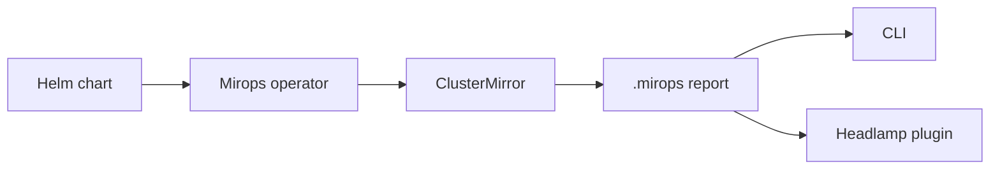

# Mirops Helm Charts

Deploy Mirops with a chart that keeps the operational path simple: install the operator, create a `ClusterMirror`, and inspect an always-current view of cluster risk.



## What is here

| Chart | Purpose |
| --- | --- |
| [`mirops-operator`](mirops-operator/) | Installs the operator, report service, RBAC, service accounts, and optional upgrade-analysis support. |

The chart is part of the open Mirops ecosystem. Review the chart values before using it in a production cluster, and contribute improvements through a focused pull request.

## Quick start

Install from this checkout:

```sh
helm install mirops ./mirops-operator \
  --namespace mirops \
  --create-namespace
```

Or install a published release:

```sh
helm install mirops oci://ghcr.io/miropshq/charts/mirops \
  --namespace mirops \
  --create-namespace \
  --version <chart-version>
```

Then create a `ClusterMirror` using the operator documentation. Upgrade analysis remains opt-in through `upgrade.enabled`; the mirror remains useful without it.

## Day-two operations

```sh
helm upgrade mirops ./mirops-operator --namespace mirops
helm template mirops ./mirops-operator --namespace mirops
helm lint ./mirops-operator
helm uninstall mirops --namespace mirops
```

For values, cloud identity examples, compatibility-matrix pinning, and verification commands, see the [chart README](mirops-operator/README.md).

## Contributing

Keep changes reviewable, render the chart locally, and do not make the chart claim capabilities that the operator does not ship. See [CONTRIBUTING.md](CONTRIBUTING.md) for the project workflow and [LICENSE](LICENSE) for licensing.
