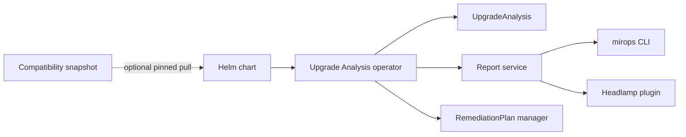

# Mirops Helm charts

Deploy the Mirops Kubernetes Upgrade Analysis operator with Helm. This repository packages the operator, its report endpoint, optional remediation manager, and compatibility-matrix publishing hook.



## Chart

| Chart | Chart version | Purpose |
| --- | --- | --- |
| [`mirops-operator`](mirops-operator/) | `0.1.0` | Installs the operator and associated report/remediation services. |

The chart source and defaults are in [`mirops-operator/`](mirops-operator/). Review those values before deploying to a cluster; in particular, choose an intentional compatibility snapshot and report-storage destination.

## Install

From this checkout:

```sh
helm upgrade --install mirops ./mirops-operator \
  --namespace mirops \
  --create-namespace
```

Or install the published chart (substitute a released chart version):

```sh
helm upgrade --install mirops oci://ghcr.io/miropshq/charts/mirops \
  --namespace mirops \
  --create-namespace \
  --version <chart-version>
```

The operator’s `UpgradeAnalysis` and `RemediationPlan` CRDs must be installed before creating those resources. See the [operator installation guide](https://github.com/miropshq/mirops#install) and [`mirops-operator/README.md`](mirops-operator/README.md) for the full setup and configuration reference.

## Render, inspect, and remove

```sh
helm lint ./mirops-operator
helm template mirops ./mirops-operator --namespace mirops
helm upgrade mirops ./mirops-operator --namespace mirops
helm uninstall mirops --namespace mirops
```

Use a single namespace-creation mechanism: `--create-namespace` (shown above), or `namespace.create=true` in values—not both. For reproducible deployments, pin image and compatibility-matrix versions instead of relying on moving tags.

## Contribute

Keep chart changes aligned with the operator code and defaults, and include rendered-manifest or lint evidence in focused pull requests. See [CONTRIBUTING.md](CONTRIBUTING.md) and the repository’s [Apache-2.0 license](LICENSE).
