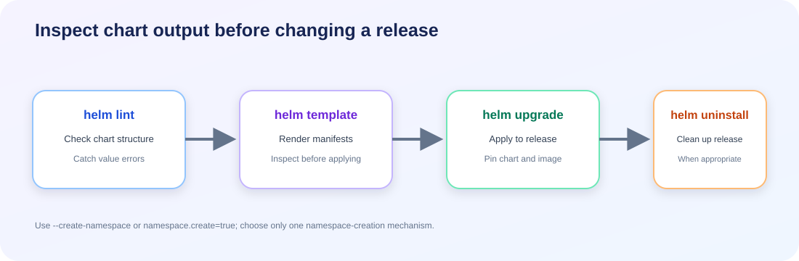

# Mirops Helm charts

Helm charts for **Mirops** — the live Kubernetes Cluster Mirror: a dependency graph of your cluster, the blast radius of whatever is down, and the risk per namespace, rebuilt continuously. Upgrade analysis is opt-in.

## Chart

| Chart | Chart version | Purpose |
| --- | --- | --- |
| [`mirops-operator`](mirops-operator/) (published as `mirops`) | `0.2.1` | Installs the operator — the always-on ClusterMirror, plus opt-in upgrade analysis — its report service and the optional remediation manager. On [Artifact Hub](https://artifacthub.io/packages/helm/mirops-operator/mirops). |

The chart creates no `ClusterMirror` or `UpgradeAnalysis`: install it, then create a ClusterMirror. The operator installs its own CRDs at startup, so there's no separate CRD step.

## Install

From the published OCI repository — it's an OCI chart, so there's no `helm repo add`:

```sh
helm install mirops oci://ghcr.io/miropshq/charts/mirops \
  --namespace mirops --create-namespace --version 0.2.1
```

From this checkout:

```sh
helm install mirops ./mirops-operator --namespace mirops --create-namespace
```

Then create a ClusterMirror, and turn on upgrade analysis only when you need it — see [`mirops-operator/README.md`](mirops-operator/README.md) for the full setup and every value, or the [docs](https://docs.mirops.com/helm/deploy).

## Render, inspect, and remove

```sh
helm lint ./mirops-operator
helm template mirops ./mirops-operator --namespace mirops
helm upgrade mirops ./mirops-operator --namespace mirops
helm uninstall mirops --namespace mirops
```

Use a single namespace-creation mechanism: `--create-namespace` (shown above), or `namespace.create=true` in values — not both. For reproducible deployments, pin the chart, image and compatibility-matrix versions instead of relying on moving tags.



## Contribute

Keep chart changes aligned with the operator code and defaults, and include rendered-manifest or lint evidence in focused pull requests. See [CONTRIBUTING.md](CONTRIBUTING.md) and the repository's [Apache-2.0 license](LICENSE).
