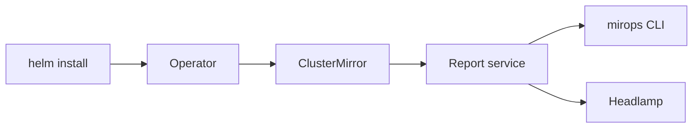
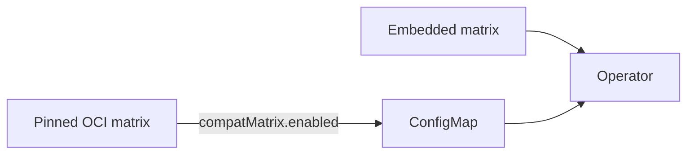

# Mirops Operator chart

The `mirops-operator` chart is the Helm entry point for Mirops: it deploys the operator, report service, identities, and permissions needed to maintain a Kubernetes Cluster Mirror.



## Install

```sh
helm upgrade --install mirops oci://ghcr.io/miropshq/charts/mirops \
  --namespace mirops \
  --create-namespace \
  --version <chart-version>
```

For a local checkout, replace the OCI reference with `./mirops-operator`.

Use one namespace-creation mechanism: pass `--create-namespace` (recommended), or set `namespace.create=true`; do not use both.

## Verify the installation

```sh
kubectl get pods -n mirops
kubectl get deployment -n mirops
kubectl logs -n mirops deployment/mirops-controller-manager
```

Create a `ClusterMirror` after the operator is running. Upgrade analysis is an optional operation on that mirror, enabled with `upgrade.enabled` when required.

## Important values

| Value | Default | Why it matters |
| --- | --- | --- |
| `image.repository` / `image.tag` | chart defaults | Select the operator image to run. |
| `namespace.create` | `false` | Lets the chart own the namespace; do not combine with `--create-namespace`. |
| `compatMatrix.enabled` | `false` | Pull a compatibility snapshot rather than using the image’s embedded snapshot. |
| `compatMatrix.version` | `latest` | Use a dated tag in production for reproducible results. |
| `upgrade.enabled` | `false` | Turns on opt-in upgrade analysis. |

### Compatibility snapshots



Leave the embedded matrix in place for air-gapped environments. When using OCI snapshots, pin a date tag in production so an analysis remains reproducible.

## Cloud workload identity

Use service-account annotations for the cloud identity already configured in your cluster: IRSA on EKS and Workload Identity on AKS. Keep credentials in Kubernetes Secrets only when workload identity is unavailable.

## Maintain the chart

```sh
helm template mirops ./mirops-operator --namespace mirops
helm lint ./mirops-operator
helm upgrade mirops ./mirops-operator --namespace mirops
helm uninstall mirops --namespace mirops
```

This chart is open source; see the repository [LICENSE](../LICENSE) and contribution guidance before submitting a change.

