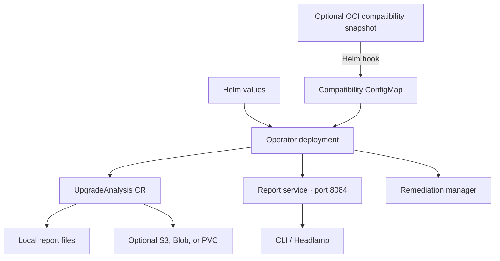

# Mirops operator chart

The `mirops` chart installs the Kubernetes Upgrade Analysis operator and its supporting report and remediation services. It is designed to make readiness results inspectable in Kubernetes and consumable by the Mirops CLI and Headlamp plugin.



## Prerequisites and installation

Install the operator’s CRDs before creating custom resources. From the operator repository, apply the generated CRDs; then install this chart:

```sh
kubectl apply -f config/crd/bases/
helm upgrade --install mirops oci://ghcr.io/miropshq/charts/mirops \
  --namespace mirops \
  --create-namespace \
  --version <chart-version>
```

For a local checkout, use `./mirops-operator` in place of the OCI reference. The chart defaults to the public operator image `ghcr.io/miropshq/mirops/operator:v0.1.0` and one replica. Keep namespace creation to one mechanism: use `--create-namespace` as above, or set `namespace.create=true`, but not both.

## Verify

```sh
kubectl get pods,deployments,services -n mirops
kubectl logs -n mirops deployment/mirops-controller-manager
helm template mirops ./mirops-operator --namespace mirops
helm lint ./mirops-operator
```

Create an `UpgradeAnalysis` after the controller is ready. The chart does not create a `ClusterMirror` resource; its supported workflow is upgrade analysis from the operator’s collected cluster state.

## Configuration highlights

| Value | Default | Use |
| --- | --- | --- |
| `image.repository`, `image.tag` | `ghcr.io/miropshq/mirops/operator`, `v0.1.0` | Operator image and version. |
| `replicaCount` | `1` | Operator replicas. |
| `rbac.create` | `true` | Create the operator’s required RBAC resources. |
| `metrics.enabled`, `metrics.port` | `true`, `8080` | Expose operator metrics configuration. |
| `reports.port`, `reports.dir` | `8084`, `/var/mirops/reports` | Report HTTP endpoint and local report directory. |
| `reportPVC.enabled` | `false` | Provision/use a PVC for on-premises persistent report storage. Keep the mount path aligned with `source.path`. |
| `compatMatrix.enabled` | `false` | Pull an OCI matrix snapshot into the operator’s compatibility ConfigMap. |
| `compatMatrix.version` | `latest` | Choose a published version; pin a dated tag for reproducible production results. |
| `remediation.enabled` | `true` | Deploy the separate remediation manager. |
| `serviceAccount.annotations` | `{}` | Configure cloud workload identity where applicable. |

See the complete, commented [`values.yaml`](values.yaml) for resource requests/limits, pod security settings, probes, leader election, image-pull settings, node scheduling, report PVC options, and compatibility pull-job images.

## Compatibility data

The operator image includes an embedded matrix, which is deterministic and works offline by default. Enable `compatMatrix.enabled` only when the cluster should pull a separately published snapshot. In production, set `compatMatrix.version` to a dated version rather than `latest`; the hook then writes the selected snapshot to the ConfigMap the operator reads. Configure `compatMatrix.pullSecret` only when mirroring the public artifact into a private registry.

## Cloud identity and report storage

The chart does not create cloud credentials. Configure the service account annotations for the identity mechanism already set up in your cluster (for example, EKS IRSA or AKS Workload Identity), and grant that identity only the required object-storage permissions. Alternatively, provide a credentials Secret as supported by the `UpgradeAnalysis` source. For persistent on-premises output, enable `reportPVC` and configure the analysis source path to match its mount path.

## Upgrade and uninstall

```sh
helm upgrade mirops ./mirops-operator --namespace mirops
helm uninstall mirops --namespace mirops
```

Back up any report data you need before uninstalling. Review rendered manifests and environment-specific values before applying a production change. Contributions are welcome under the repository’s [Apache-2.0 license](../LICENSE); follow [`CONTRIBUTING.md`](../CONTRIBUTING.md).
